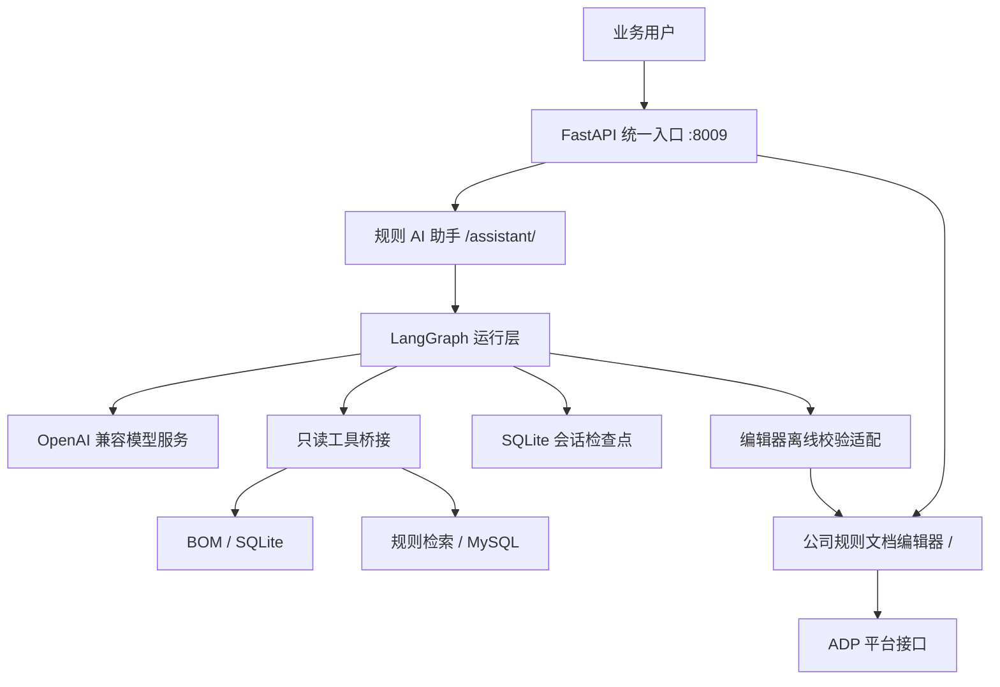

# LangGraph Underwriting Agent

基于 **LangGraph** 开发的核保规则 Agent，对接公司的 **ADP 规则文档编辑器**，将业务问答、规则检索、规则草拟与编辑器校验整合到一个工作台。

Agent 负责结合业务对象模型（BOM）和已有规则辅助编写规则；文档编辑器负责规则编辑、候选提示、语法校验、结构化转换及平台对接。两者通过 FastAPI 统一提供服务，共用一个 HTTP 端口。

## 主要能力

- **LangGraph Agent**：模型与工具循环、上下文预算管理、摘要压缩、任务取消及超时控制。
- **业务检索**：通过 `bom_search` 和 `rule_search` 查询 BOM 字段、方法和已有规则，使用只读工具为答复提供依据。
- **流式交互**：Vue 3 网页配合 SSE 展示任务进度和最终答复，支持附件文本提取、会话管理与 SQLite 检查点。
- **规则文档编辑器对接**：提供规则候选、标注、校验、JSON 生成与本地求值能力，保留编辑器自身的登录及 ADP 对接流程。
- **统一工作台**：`/assistant/` 为规则 AI 助手，`/` 为规则文档编辑器，顶部导航可在两者之间切换。

助手生成的内容可通过“复制并到编辑器验证”进入编辑器，仍需手动粘贴。规则保存和平台上传由用户在编辑器中操作；模型工具仅开放只读检索。

## 架构



## 技术栈

| 模块 | 技术 |
| --- | --- |
| Agent 编排 | Python、LangGraph |
| 模型接入 | OpenAI 兼容接口 |
| 服务与流式通信 | FastAPI、Uvicorn、SSE |
| 网页界面 | Vue 3、原生 JavaScript / HTML / CSS |
| 检索与数据 | Node.js、SQLite、MySQL |
| 规则处理 | BOM 驱动的候选、校验与结构化转换 |

## 快速开始

需要 Python 3.12、Node.js 22.5 或更高版本，以及可访问的模型服务和配套业务数据。仓库不包含真实凭据、业务 BOM、数据库、运行时检查点或依赖目录。

### 1. 下载并安装依赖

```powershell
git clone https://github.com/zph-lab/langgraph-underwriting-agent.git
cd langgraph-underwriting-agent
py -3.12 -m venv .venv
.\.venv\Scripts\python.exe -m pip install -r requirements.txt
Push-Location 'ar_agent开发/agent_1/airong_agent_test1'
npm ci
Pop-Location
```

### 2. 配置模型、检索和编辑器

将示例配置复制到本地运行路径：

```powershell
$agentDir = 'ar_agent开发/agent_1/airong_agent_test1'
New-Item -ItemType Directory -Force "$agentDir/config" | Out-Null
Copy-Item config-examples/models.example.json "$agentDir/.pi/models.json"
Copy-Item config-examples/mysql.example.json "$agentDir/config/mysql.json"
Copy-Item config-examples/rule-editor.example.json "$agentDir/config/rule-editor.json"
Copy-Item config-examples/editor.config.example.yaml rule_editor_new/rule_editor/config.yaml
$env:AGENT_API_KEY = 'YOUR_API_KEY'
```

以上复制步骤用于首次配置。填写模型服务地址和模型 ID，并与助手 `.pi/settings.json` 中的 provider、model 保持一致；填写 MySQL 连接、编辑器登录账号密码，以及所需 ADP 参数。

另需准备匹配的 BOM、方法注册表和 SQLite 检索数据，并在配置中设置实际路径。示例中的登录账号密码为空，必须填写后才能登录。数据准备和配置细节见 [分发版配置说明](GITHUB_SETUP.md) 与 [数据更换指南](rule_editor_new/数据更换指南.md)。

### 3. 启动工作台

```powershell
powershell -ExecutionPolicy Bypass -File .\start.ps1
```

- 规则文档编辑器：<http://127.0.0.1:8009/>
- 规则 AI 助手：<http://127.0.0.1:8009/assistant/>

可使用 `-Port 8010` 更改端口，或使用 `-BindHost 0.0.0.0` 监听局域网地址。统一入口会将助手的编辑器校验地址绑定到实际端口。终端按 `Ctrl+C` 停止服务。

部署时保持单 worker：编辑器登录会话存于进程内。页面切换会重新加载，草稿和历史沿用原有存储恢复机制，未发送附件不跨页面保留。

## 项目结构

```text
.
├── merged_app.py                 # 两套 ASGI 应用挂载与生命周期管理
├── start.py / start.ps1          # 统一启动入口
├── requirements.txt             # Python 依赖入口
├── config-examples/             # 不含真实凭据的配置示例
├── ar_agent开发/agent_1/airong_agent_test1/
│   ├── langgraph_app/           # Agent 编排、模型、会话、编辑器适配
│   ├── backend/                 # HTTP、SSE 和附件接口
│   ├── tools/                   # BOM / 规则检索与工具桥接
│   ├── web/                     # 助手前端
│   ├── .pi/                     # 提示词、Skills 与模型选择配置
│   └── tests/                   # Agent 回归检查
├── rule_editor_new/             # 公司规则文档编辑器及转换、校验模块
├── tests/                       # 合并入口与导航检查
└── docs/                        # 开发、部署与交接文档
```

`legacy/pi` 保留历史实现，当前工作台的 Agent 运行层为 `langgraph_app`。

## 验证

安装依赖并配置配套本地数据后，可运行合并集成检查与导航检查：

```powershell
.\.venv\Scripts\python.exe -m unittest discover -s tests -v
node tests/navigation.cjs
```

合并测试涉及本地编辑器配置与数据。模型生成质量、外部数据库连通性和真实 ADP 上传需在目标环境单独验收；离线检查通过不能替代平台联调。

## 开发文档

- [Agent 业务助手开发文档](docs/02_Agent业务助手开发文档.md)：LangGraph、模型、工具、SSE 与会话机制。
- [文档编辑器开发文档](docs/01_文档编辑器开发文档.md)：BOM、注册表、规则语法及转换校验。
- [项目启动部署文档](docs/03_项目启动部署文档.md)：安装配置、部署与排障。
- [分发版配置说明](GITHUB_SETUP.md)：克隆后的配置及业务数据准备。

## 版本管理与许可

`.gitignore` 已排除本地密钥和配置、业务数据、数据库、依赖目录、日志、缓存、构建产物和临时工作区。运行配置使用 `config-examples/` 中的示例自行创建。

当前项目未附带开源许可证；第三方资源遵循各自许可。
