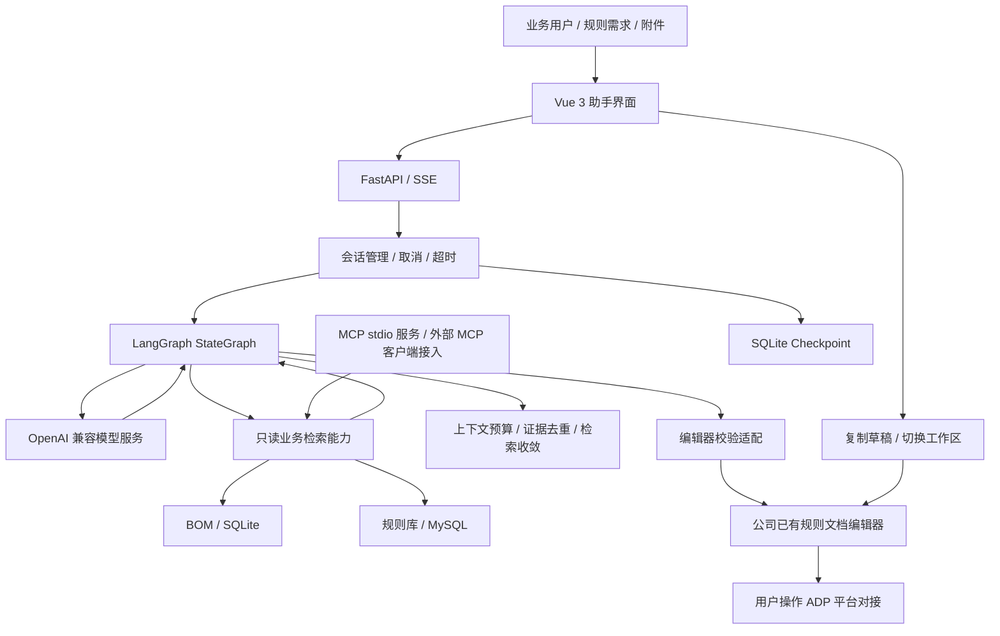

# LangGraph Underwriting Agent

面向核保规则开发的 AI Agent：基于 **LangGraph** 编排模型与检索工具，结合业务对象模型（BOM）和已有规则，为业务人员提供规则问答、字段映射、规则草拟和文档转写辅助，并与公司已有规则文档编辑器整合为统一工作台。

## 业务问题与功能价值

| 业务问题 | Agent 提供的能力 | 价值与交付方式 |
| --- | --- | --- |
| 规则分散、人工查找成本高 | 自然语言检索已有核保规则 | 辅助定位参考规则，展示条件与动作，减少反复查找 |
| BOM 层级深、同名字段多 | 字段、方法、类型与完整父链检索 | 为规则映射提供业务对象依据，辅助识别同名候选 |
| 业务描述难以直接形成规范规则 | 结合提示词、领域 Skills 和检索证据生成草稿 | 按规范输出预定义、条件与动作，缺失信息列为待确认 |
| 条款需要逐条转写 | 附件文本提取、规则转写及来源标记 | 支持从材料形成可审核草稿，保留来源供人工复核 |
| AI 草稿与规则工具割裂 | 统一导航、编辑器校验适配、单端口部署 | 将生成结果带入现有编辑流程，复用公司成熟规则能力 |

以上是已实现的辅助流程与预期使用价值，尚未量化人工工时或线上业务收益。助手的“复制并到编辑器验证”仍需手动粘贴；规则保存及上传由用户在编辑器中操作。

## Agent 架构



核心流程为：接收需求 → 加载领域提示与 Skills → LangGraph 编排模型和工具循环 → 获取 BOM 与规则证据 → 生成与检查交付格式 → 流式返回答复 → 用户进入编辑器继续验证。

## 技术实现与工程设计

| 层次 | 技术及实现 | 解决的问题 |
| --- | --- | --- |
| Agent 编排 | Python、LangGraph `StateGraph`，模型 / 工具循环及条件收尾 | 将多轮检索、生成与任务状态组织为可控流程 |
| 模型接入 | OpenAI 兼容流式接口、工具 Schema、错误诊断与重试 | 对接部署模型，统一增量输出和调用异常处理 |
| MCP 工具服务 | MCP Python SDK、FastMCP、stdio，暴露 `bom_search` / `rule_search` | 让只读业务检索能力可被标准 MCP 客户端复用 |
| 上下文治理 | 模型输入证据视图、重复结果引用、预算检查、检索收敛 | 减少重复证据开销，限制无效循环，保留原始证据 |
| 运行管理 | SQLite Checkpoint、独立会话、取消、任务期限与调用预算 | 支持会话恢复和失败收尾，约束长任务资源消耗 |
| 交互与服务 | FastAPI、SSE、Vue 3、附件文本提取 | 展示任务阶段、工具进度与最终答复 |
| 业务数据 | Node.js 检索核心、SQLite BOM、MySQL 规则库 | 复用业务字段与已有规则，而非仅依赖模型记忆 |
| 系统集成 | ASGI 子应用挂载、生命周期管理、同源路径、校验适配 | 将 Agent 与公司已有编辑器合并为单进程、单端口工作台 |

## 在线 API 模型评测

以 Agent 接入在线 API 大模型后的实际任务表现为基准，重点关注调用成本、等待时间和业务效果。固定模型版本、参数、提示词、数据和测试输入，比较不同模型或优化前后的结果。

| 指标 | 统计方式 |
| --- | --- |
| 累计输入 Token | 一次 Agent 任务内，所有模型请求的输入 Token 之和，包含检索后的多轮调用、摘要和修正 |
| 累计输出 Token | 同一任务内，所有模型请求的输出 Token 之和；使用 API 返回的 usage |
| 首 Token 时间 | 单次模型 API 请求发出至首个非空输出增量的时间；按正文、工具调用或推理输出标记类型，正文等待时间单列 |
| 响应时间 | 用户提交任务至 Agent 返回最终结果并结束的总耗时，包含检索和多轮模型调用 |
| 转换准确率 | 条件、比较边界、逻辑及动作参数均与参考答案一致的转换任务数 ÷ 全部转换任务数 |
| 检索准确率 | 最终结果中正确命中标注目标的检索任务数 ÷ 全部检索任务数；每例固定返回数量 |

Token 使用 API 的实际 usage，缺失时标为未采集，不以字符数替代。失败和超时计入准确率分母，超时单独记录，不能当作成功响应耗时。当前先报告每例结果与平均耗时；P95 / P99 作为后续有足够请求记录时的可选指标。

完整操作与记录格式见 [在线 API 评测说明](docs/AGENT_ARCHITECTURE_AND_EVALUATION.md#在线-api-模型评测)。

## API 模型任务评测对比

2026-10-30，针对同一组 4 条规则需求进行前后复测，每条使用独立会话、各运行一次。下表采用 HTTP/SSE 任务记录及模型 API usage，与早期本地部署 Qwen 模型实验分开。

| 指标 | 优化前 | 优化后 | 变化 |
| --- | ---: | ---: | --- |
| 累计输入 Token（4 个任务） | 519,830 | 477,114 | 减少 8.22% |
| 累计输出 Token（4 个任务） | 8,458 | 7,615 | 减少 9.97% |
| 平均首文本延迟（TTFT 代理） | 1.196 秒 | 1.395 秒 | 增加 16.64% |
| 平均最终响应时间（含离线校验） | 31.678 秒 | 40.892 秒 | 增加 29.09% |
| 平均任务总耗时（至任务结束事件） | 31.694 秒 | 40.908 秒 | 增加 29.07% |

优化后累计输入输出 Token 减少约 8.25%，任务响应时间未改善。两组模型请求均为 17 次，usage 完整；当前保留的复测逐例任务耗时为 35.65—47.51 秒。

首文本延迟是首次模型请求至首个非空文本增量，不能覆盖所有工具参数的首 Token。每组仅 4 个样例、各一次，模型负载与随机性未完全控制。原记录没有保存每次请求的模型 ID，具体提供方与模型版本待补核，不与本地 Qwen 实验混为同一组。完整转换准确率和检索准确率仍待单独标注评测。

[聚合数据](docs/API_TASK_COMPARISON_20261030.json) · [评测口径与历史记录](docs/AGENT_ARCHITECTURE_AND_EVALUATION.md#历史-api-任务对比数据)

## 快速开始

需要 Python 3.12、Node.js 22.5 或更高版本，以及可访问的模型服务和配套业务数据。仓库不包含真实凭据、业务 BOM、数据库、运行时检查点或依赖目录。

### 1. 下载并安装依赖

```powershell
git clone https://github.com/zph-lab/langgraph-underwriting-agent.git
cd langgraph-underwriting-agent
py -3.12 -m venv .venv
.\.venv\Scripts\python.exe -m pip install -r requirements.txt
Push-Location 'ar_agent开发/agent_1/airong_agent_test1'
npm ci
Pop-Location
```

### 2. 配置模型、检索和编辑器

将示例配置复制到本地运行路径：

```powershell
$agentDir = 'ar_agent开发/agent_1/airong_agent_test1'
New-Item -ItemType Directory -Force "$agentDir/config" | Out-Null
Copy-Item config-examples/models.example.json "$agentDir/.pi/models.json"
Copy-Item config-examples/mysql.example.json "$agentDir/config/mysql.json"
Copy-Item config-examples/rule-editor.example.json "$agentDir/config/rule-editor.json"
Copy-Item config-examples/editor.config.example.yaml rule_editor_new/rule_editor/config.yaml
$env:AGENT_API_KEY = 'YOUR_API_KEY'
```

以上复制步骤用于首次配置。填写模型服务地址和模型 ID，并与助手 `.pi/settings.json` 中的 provider、model 保持一致；填写 MySQL 连接、编辑器登录账号密码，以及所需 ADP 参数。

另需准备匹配的 BOM、方法注册表和 SQLite 检索数据，并在配置中设置实际路径。示例中的登录账号密码为空，必须填写后才能登录。数据准备和配置细节见 [分发版配置说明](GITHUB_SETUP.md) 与 [数据更换指南](rule_editor_new/数据更换指南.md)。

### 3. 启动工作台

```powershell
powershell -ExecutionPolicy Bypass -File .\start.ps1
```

- 规则文档编辑器：<http://127.0.0.1:8009/>
- 规则 AI 助手：<http://127.0.0.1:8009/assistant/>

可使用 `-Port 8010` 更改端口，或使用 `-BindHost 0.0.0.0` 监听局域网地址。统一入口会将助手的编辑器校验地址绑定到实际端口。终端按 `Ctrl+C` 停止服务。

部署时保持单 worker：编辑器登录会话存于进程内。页面切换会重新加载，草稿和历史沿用原有存储恢复机制，未发送附件不跨页面保留。

## 项目结构

```text
.
├── merged_app.py                 # 两套 ASGI 应用挂载与生命周期管理
├── start.py / start.ps1          # 统一启动入口
├── requirements.txt             # Python 依赖入口
├── config-examples/             # 不含真实凭据的配置示例
├── ar_agent开发/agent_1/airong_agent_test1/
│   ├── langgraph_app/           # Agent 编排、模型、会话、编辑器适配
│   ├── backend/                 # HTTP、SSE 和附件接口
│   ├── mcp_service/             # MCP stdio 服务与只读工具注册
│   ├── tools/                   # BOM / 规则检索核心实现
│   ├── web/                     # 助手前端
│   ├── .pi/                     # 提示词、Skills 与模型选择配置
│   └── tests/                   # Agent 回归检查
├── rule_editor_new/             # 公司已有编辑器（集成依赖，非个人原创模块）
├── tests/                       # 合并入口与导航检查
└── docs/                        # 开发、部署与交接文档
```

`legacy/pi` 保留历史实现，当前工作台的 Agent 运行层为 `langgraph_app`。

## 验证

安装依赖并配置配套本地数据后，可运行合并集成检查与导航检查：

```powershell
.\.venv\Scripts\python.exe -m unittest discover -s tests -v
node tests/navigation.cjs
```

合并测试涉及本地编辑器配置与数据。模型生成质量、外部数据库连通性和真实 ADP 上传需在目标环境单独验收；离线检查通过不能替代平台联调。

## 开发文档

- [Agent 架构、技术与评测说明](docs/AGENT_ARCHITECTURE_AND_EVALUATION.md)：个人开发范围、MCP 接入、评测体系与实测边界。

- [Agent 业务助手开发文档](docs/02_Agent业务助手开发文档.md)：LangGraph、模型、工具、SSE 与会话机制。
- [文档编辑器开发文档](docs/01_文档编辑器开发文档.md)：BOM、注册表、规则语法及转换校验。
- [项目启动部署文档](docs/03_项目启动部署文档.md)：安装配置、部署与排障。
- [分发版配置说明](GITHUB_SETUP.md)：克隆后的配置及业务数据准备。

## 版本管理与许可

`.gitignore` 已排除本地密钥和配置、业务数据、数据库、依赖目录、日志、缓存、构建产物和临时工作区。运行配置使用 `config-examples/` 中的示例自行创建。

当前项目未附带开源许可证；第三方资源遵循各自许可。
